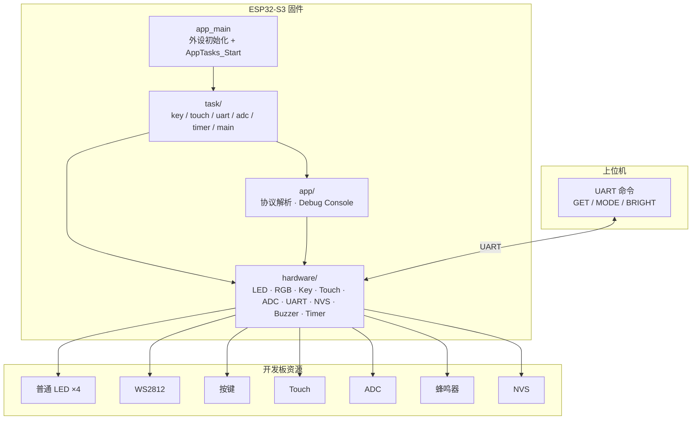
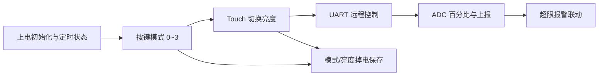

# Esp32s3_Contest_Lab

ESP32-S3 **全国大学生嵌入式芯片与系统设计竞赛 · 乐鑫赛道** 模拟题工程与分层模板。

基于 ESP-IDF + FreeRTOS：`hardware`（HAL）/ `app`（业务）/ `task`（任务外壳）分离；包含多套 demo 与赛题说明。

## 系统架构图



## 功能框图（赛题能力）



## 仓库结构

| 路径 | 说明 |
|------|------|
| `demo/` / `demo1/` / `demo2/` | 多套 ESP-IDF 工程（结构对齐） |
| `demo*/main/hardware/` | HAL：LED、RGB、按键、Touch、ADC、UART、NVS、蜂鸣器、定时器 |
| `demo*/main/app/` | 协议与调试控制台 |
| `demo*/main/task/` | FreeRTOS 任务与 `task_manager` |
| `demo*/docs/` | 乐鑫赛道一小时/两小时模拟题与 RGB 色表 |
| `docs/` | VSCode 补全与跳转说明 |
| `output/` | 导出材料（如 PDF） |

## 构建提示

在对应 `demo*` 目录下使用 ESP-IDF 环境：

```bat
idf.py set-target esp32s3
idf.py build flash monitor
```

或使用目录内 `build.bat`（需本机已配置 IDF）。

## 远程

```text
origin → https://github.com/linxi27667/Esp32s3_Contest_Lab.git
```

本地常见路径：`E:\MCU\esp32\ESP_BSP_IN_QIANSAI`
